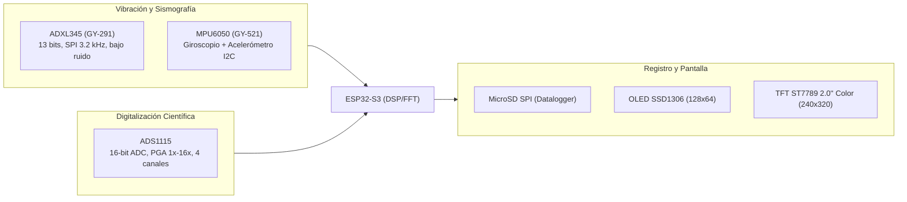

# Lista de Compra v1.2 --- Laboratorios ESP32, Adquisición Científica, Vibraciones y Física Moderna

> **v1.2 — Servo Motor + Proyectos actualizados:** Servo SG90/MG90S como excitador de resonancia y pan-tilt de cámara. Secciones 6 (resonancia), 10 (visión) y 11 (prioridades) actualizadas. Links verificados. 11 componentes faltantes documentados.


> **Archivo complementario de cotización:** [Matriz_Proveedores_ESP32_Laboratorios.xlsx](file:///D:/00_FisicaModerna/proyecto_IoT/Matriz_Proveedores_ESP32_Laboratorios.xlsx)  
> *Incluye fórmulas automáticas de ahorro Cyber, hipervínculos directos a tiendas chilenas y análisis comparativo de ingeniería.*

---

## Objetivo

Construir un ecosistema modular de **instrumentación científica programable y adquisición de datos** basado en la arquitectura **ESP32-S3**, orientado a:
1. **Adquisición Científica de Alta Precisión:** Digitalización de fenómenos de física moderna (curvas I-V, decaimiento exponencial RC/RLC, efecto fotoeléctrico y sensores analógicos) superando la no-linealidad del ADC interno mediante un convertidor externo de 16 bits.
2. **Laboratorio de Vibraciones y Sismografía:** Captura de aceleración triaxial $a(t)$, filtrado digital, cálculo de transformada rápida de Fourier (FFT), determinación de frecuencias dominantes y modos de vibración.
3. **Resonancia Mecánica Forzada:** Caracterización activa del factor de calidad $Q$, amortiguamiento y curvas de respuesta en frecuencia $H(f)$ mediante un subsistema excitador controlado por el ESP32.
4. **Extensión de Visión Artificial:** Registro óptico de posición $x(t)$ para contrastar con la aceleración inercial $a(t)$.

---

## 1. Arquitecturas y Plataformas de Cómputo

### Plataforma Principal: ESP32-S3 Tradicional
* **Modelo:** ESP32-S3 N16R8 (16 MB Flash Quad SPI, 8 MB Octal PSRAM, 44 pines, USB-C).
* **Función:** Núcleo de adquisición científica, procesamiento local de señales mediante instrucciones vectoriales DSP, comunicación por buses I2C/SPI y transferencia de datos por USB-CDC, Wi-Fi o Bluetooth hacia la estación de análisis.

### Extensión de Visión: Seeed Studio XIAO ESP32-S3 Sense
* **Modelo:** XIAO ESP32-S3 Sense (Cámara OV2640 de 2 MP, ranura microSD y micrófono MEMS digital).
* **Función:** Captura óptica de posición $x(t)$ mediante seguimiento de marcadores (AruCo o color) para contrastar con el sensor inercial. Es una opción de extensión y no reemplaza al ESP32-S3 principal.

### Nodos Secundarios y Prototipado Rápido
* **ESP32 DevKit 30P (ESP-WROOM-32):** Banco de pruebas secundario para validación aislada de periféricos y actuadores sin comprometer la placa S3 principal.
* **ESP32-C3 Super Mini (RISC-V):** Tarjeta ultracompacta y de bajo consumo para nodos remotos de telemetría y balizas sismográficas portátiles.

---

## 2. Matriz Principal de Proveedores y Precios Cyber

> Precios en pesos chilenos (**CLP**). Precios Cyber corresponden a referencias observadas o valores objetivo de liquidación.  
> ⚠️ **Links:** Los marcados con 🔍 apuntan a búsqueda (producto no encontrado con URL directa); los marcados con ✅ tienen URL verificada.

| ID | Producto / Módulo | SMDByte | MCI Electronics | MechatronicStore | AFEL | Victronics | Ref. Normal | Ref. Cyber | Proveedor Recomendado | Link Directo |
| :---: | :--- | :---: | :---: | :---: | :---: | :---: | :---: | :---: | :--- | :--- |
| **1** | **ESP32-S3 N16R8 (44P, USB-C)** | \$10.990 | \$12.990 | --- | --- | --- | \$11.990 | \$9.990 | SMDByte / MCI | [Ver en MCI](https://mcielectronics.cl/shop/product/esp32-s3-devkitc-1-n16r8/) |
| **2** | **Seeed XIAO ESP32-S3 Sense** | --- | \$19.990 | \$22.990 | --- | --- | \$22.990 | \$19.990 | MCI / Mechatronic | ✅ [Ver en Mechatronic](https://www.mechatronicstore.cl/seeed-studio-xiao-esp32-s3-sense/) |
| **3** | **ESP32 DevKit 30 Pines (ESP-WROOM-32)** | \$6.990 | \$8.990 | \$6.990 | --- | --- | \$6.990 | \$5.990 | MechatronicStore | 🔍 [Buscar en Mechatronic](https://www.mechatronicstore.cl/?s=esp32+devkit+30&post_type=product) |
| **4** | **ESP32-C3 Super Mini (RISC-V)** | \$4.990 | --- | \$7.990 | --- | --- | \$6.290 | \$4.990 | SMDByte / Mechatronic | 🔍 [Buscar en Mechatronic](https://www.mechatronicstore.cl/?s=esp32+c3+mini&post_type=product) |
| **5** | **Sensor MPU6050 (GY-521)** | --- | \$5.990 | \$4.490 | \$4.000 | \$2.870 | \$4.490 | \$2.870 | Victronics (Mejor precio) | [Ver en MCI](https://mcielectronics.cl/shop/product/modulo-acelerometro-giroscopio-mpu6050/) |
| **6** | **Acelerómetro ADXL345 (GY-291) [Mejora]** | --- | \$4.690 | \$3.490 | \$3.800 | --- | \$3.490 | \$2.990 | MechatronicStore | ✅ [Ver en Mechatronic](https://www.mechatronicstore.cl/acelerometro-digital-3-ejes-adxl345-gy-291/) |
| **7** | **Módulo ADC 16-Bit ADS1115 (PGA) [Mejora]** | --- | \$4.990 | \$5.490 | \$5.000 | --- | \$4.990 | \$4.290 | MCI Electronics | [Ver en MCI](https://mcielectronics.cl/shop/product/modulo-adc-conversor-analogico-digital-16-bit-ads1115/) |
| **8** | **Driver MOSFET PWM IRF520 / Excitador [Mejora]** | --- | \$2.490 | \$1.990 | \$1.800 | --- | \$1.990 | \$1.490 | MechatronicStore / AFEL | ✅ [Ver en Mechatronic](https://www.mechatronicstore.cl/driver-mosfet-irf520/) |
| **9** | **Fotopuerta Óptica LM393 [Mejora]** | --- | --- | \$1.490 | \$1.500 | \$1.290 | \$1.490 | \$990 | MechatronicStore / AFEL | 🔍 [Buscar en Mechatronic](https://www.mechatronicstore.cl/?s=sensor+optico+ranurado&post_type=product) |
| **10** | **Pantalla OLED 0.96" SSD1306 I2C** | \$4.990 | \$5.490 | \$5.490 | --- | --- | \$4.990 | \$3.990 | SMDByte / Mechatronic | 🔍 [Buscar en Mechatronic](https://www.mechatronicstore.cl/?s=oled+ssd1306&post_type=product) |
| **11** | **Pantalla Color TFT IPS 2.0" ST7789 [Mejora]**| --- | --- | \$8.990 | \$8.500 | --- | \$8.990 | \$6.990 | MechatronicStore | 🔍 [Buscar en Mechatronic](https://www.mechatronicstore.cl/?s=tft+st7789&post_type=product) |
| **12** | **Módulo MicroSD SPI** | \$1.490 | --- | \$1.990 | --- | --- | \$1.990 | \$1.290 | MechatronicStore | ✅ [Ver en Mechatronic](https://www.mechatronicstore.cl/modulo-lector-micro-sd/) |
| **13** | **Amplificador Operacional LM358 DIP** | \$990 | --- | \$990 | --- | \$650 | \$990 | \$590 | Victronics / Mechatronic | ✅ [Ver en Mechatronic](https://www.mechatronicstore.cl/lm358-amplificador-operacional/) |
| **14** | **Regulador Buck DC-DC LM2596** | \$2.490 | --- | \$1.990 | \$2.200 | --- | \$1.990 | \$1.290 | MechatronicStore | 🔍 [Buscar en Mechatronic](https://www.mechatronicstore.cl/?s=lm2596+step+down&post_type=product) |
| **15** | **Cargador Li-Ion TP4056 USB-C** | \$1.490 | --- | \$1.490 | \$1.500 | --- | \$1.490 | \$990 | MechatronicStore / AFEL | 🔍 [Buscar en Mechatronic](https://www.mechatronicstore.cl/?s=tp4056&post_type=product) |
| **16** | **Kit Resistencias 1/4W 1% (600 pcs)** | \$5.490 | --- | \$5.990 | --- | --- | \$5.490 | \$4.490 | SMDByte / Mechatronic | 🔍 [Buscar en Mechatronic](https://www.mechatronicstore.cl/?s=kit+resistencias+600&post_type=product) |
| **17** | **Kit Capacitores Cerámicos (100 pcs)** | \$2.490 | --- | \$2.990 | --- | --- | \$2.490 | \$1.990 | SMDByte / Mechatronic | 🔍 [Buscar en Mechatronic](https://www.mechatronicstore.cl/?s=kit+capacitores+ceramicos&post_type=product) |
| **18** | **Cables Dupont Macho-Macho 20 cm (40 uds)** | \$6.990 | \$2.990 | \$3.490 | --- | --- | \$3.490 | \$2.490 | MechatronicStore / MCI | ✅ [Ver en Mechatronic](https://www.mechatronicstore.cl/cable-macho-macho-40-piezas-20cm/) |
| **19** | **Protoboard 830 Puntos** | --- | \$3.990 | \$3.790 | \$3.500 | --- | \$3.790 | \$2.890 | MechatronicStore / AFEL | ✅ [Ver en Mechatronic](https://www.mechatronicstore.cl/protoboard-830-puntos-gl-12/) |
| **20** | **Pack Placas Perforadas FR4 (x4)** | \$1.990 | --- | \$2.490 | --- | --- | \$1.990 | \$1.590 | SMDByte / Mechatronic | 🔍 [Buscar en Mechatronic](https://www.mechatronicstore.cl/?s=placa+perforada+pcb&post_type=product) |
| **21** | **Pulsadores Táctiles 6x6 mm (x10)** | \$590 | --- | \$990 | --- | --- | \$990 | \$490 | SMDByte / Mechatronic | ✅ [Ver en Mechatronic](https://www.mechatronicstore.cl/push-button-4-pines/) |
| **22** | **Analizador Lógico USB 8CH 24MHz** | --- | --- | \$9.190 | \$10.000 | --- | \$9.190 | \$7.990 | MechatronicStore / AFEL | ✅ [Ver en Mechatronic](https://www.mechatronicstore.cl/analizador-depurador-logico-usb-24mhz-8-canales/) |
| **23** | **Multímetro Digital MAS-830L** | --- | --- | \$9.490 | \$8.900 | --- | \$9.490 | \$7.990 | MechatronicStore / AFEL | 🔍 [Buscar en Mechatronic](https://www.mechatronicstore.cl/?s=multimetro+digital&post_type=product) |
| **24** | **Kit Cautín Soldador Regulable** | --- | --- | \$14.900 | \$13.500 | --- | \$14.900 | \$11.990 | MechatronicStore / AFEL | ✅ [Ver en Mechatronic](https://www.mechatronicstore.cl/kit-de-soldadura-fina-con-cautin-regulable-pelacable-estano-y-mas/) |
| **25** | **Estaño para Soldar 60/40 de 0.8–1 mm** | --- | --- | \$2.890 | \$2.900 | \$2.700 | \$2.890 | \$2.190 | MechatronicStore / Victronics | ✅ [Ver en Mechatronic](https://www.mechatronicstore.cl/estano-soldadura-16g-60-40-1mm-ts-500/) |
| **26** | **Flux en Pasta / Jeringa (ZD-170)** | --- | --- | \$2.990 | \$2.500 | --- | \$2.990 | \$1.990 | MechatronicStore / AFEL | ✅ [Ver en Mechatronic](https://www.mechatronicstore.cl/pasta-para-soldar-zd-170-100gr/) |
| **27** | **Pinzas de Precisión Antimagnéticas (x4)** | --- | --- | \$2.990 | \$3.200 | --- | \$2.990 | \$2.290 | MechatronicStore / AFEL | ✅ [Ver en Mechatronic](https://www.mechatronicstore.cl/set-de-4-pinzas-de-precision-antimagneticas-harden/) |
| **28** | **Alicate Cortador al Ras (Plato 170)** | --- | --- | \$2.490 | \$2.300 | --- | \$2.490 | \$1.790 | MechatronicStore / AFEL | 🔍 [Buscar en Mechatronic](https://www.mechatronicstore.cl/?s=alicate+cortador&post_type=product) |
| **29** | **Pelacables de Precisión AWG 20-30** | --- | --- | \$4.490 | \$4.200 | --- | \$4.490 | \$3.490 | MechatronicStore / AFEL | 🔍 [Buscar en Mechatronic](https://www.mechatronicstore.cl/?s=pelacables&post_type=product) |
| **30** | **Malla Desoldadora de Cobre 2.0 mm** | --- | --- | \$2.190 | \$2.000 | --- | \$2.190 | \$1.690 | MechatronicStore / AFEL | ✅ [Ver en Mechatronic](https://www.mechatronicstore.cl/malla-desoldadora-zhen-dong-1-5m/) |
| **31** | **Bomba Desoldadora por Succión** | --- | --- | \$2.690 | \$2.500 | --- | \$2.690 | \$1.990 | MechatronicStore / AFEL | 🔍 [Buscar en Mechatronic](https://www.mechatronicstore.cl/?s=bomba+desoldadora&post_type=product) |
| **32** | **Soporte Tercera Mano con Lupa + LED** | --- | --- | \$5.990 | \$5.500 | --- | \$5.990 | \$4.490 | MechatronicStore / AFEL | ✅ [Ver en Mechatronic](https://www.mechatronicstore.cl/tercera-mano-con-lupa-porta-cautin-y-luz-led/) |
| **33** | **Kit Destornilladores de Precisión (25 en 1)**| --- | --- | \$4.990 | \$4.500 | --- | \$4.990 | \$3.790 | MechatronicStore / AFEL | ✅ [Ver en Mechatronic](https://www.mechatronicstore.cl/kit-destornilladores-de-precision/) |
| **34** | **Caja Organizadora Plástica** | --- | --- | \$4.990 | \$4.500 | --- | \$4.990 | \$3.790 | MechatronicStore / AFEL | 🔍 [Buscar en Mechatronic](https://www.mechatronicstore.cl/?s=caja+organizadora&post_type=product) |


---


## 3. Herramientas e Instrumentación de Laboratorio

Para garantizar la reproducibilidad y confiabilidad del ensamblaje electrónico:
* **Analizador Lógico USB 8 Canales 24 MHz:** Diagnóstico fundamental de protocolos digitales I2C y SPI. Permite inspeccionar tramas en tiempo real con PulseView/Sigrok, verificar tasas de muestreo y detectar colisiones en el bus.
* **Multímetro Digital:** Verificación obligatoria de voltajes de riel ($3.3\text{ V}$ y $5.0\text{ V}$), ausencia de cortocircuitos antes de energizar y calibración de divisores de tensión.
* **Kit de Soldadura Térmica Regulable:** Soldador de 60 W con dial térmico ($200\text{–}450^\circ\text{C}$), puntas 900M, estaño eutéctico 60/40 y flux no corrosivo en jeringa para fijar terminales sin recalentar chips sensibles.
* **Herramientas de Precisión Mecánica:** Pinzas ESD, alicate de corte diagonal Plato 170, pelacables calibrado, malla desoldadora y soporte tipo tercera mano.

---

## 4. Analizador Lógico USB: Diagnóstico Decisivo

El analizador lógico USB de 8 canales a 24 MS/s es una herramienta prioritaria:
```text
ESP32-S3 ─── I2C (SCL/SDA) ──┬── OLED SSD1306 (0x3C)
                             ├── ADS1115 (0x48)
                             └── MPU6050 (0x68)
         ─── SPI (MOSI/MISO/SCK/CS) ── ADXL345 / MicroSD
         ─── CH0..CH7 ─────────────── Analizador Lógico USB (PulseView)
```

**Funciones Clave:**
1. Determinar el tiempo real de transacción de lectura del acelerómetro.
2. Comprobar que la frecuencia de muestreo programada en el temporizador del ESP32 no sufre de deriva (*jitter*).
3. Detectar bloqueos por falta de resistencias *pull-up* adecuadas en el bus I2C.

---

## 5. Sensores y Módulos de Medición



### Acelerómetro Instrumental ADXL345 (Recomendado frente al MPU6050)
* **Resolución fija de 13 bits:** $4\text{ mg/LSB}$ en todos los rangos (hasta $\pm 16\text{ g}$).
* **Interfaz SPI de alta velocidad:** Hasta 5 MHz, alcanzando tasas de salida de datos (ODR) de $3200\text{ Hz}$ sin saturar el bus, a diferencia de los $400\text{ kHz}$ del bus I2C del MPU6050.
* **Bajo piso de ruido:** Permite capturar vibraciones de muy baja amplitud sin artefactos en la FFT.

### Convertidor Analógico-Digital ADS1115 (16 Bits)
* Resuelve el error sistemático del ADC interno del ESP32.
* Amplificador de ganancia programable (PGA) con sensibilidades de hasta $0.0078\text{ mV/LSB}$ (en rango $\pm 0.256\text{ V}$), ideal para acoplar directamente termocuplas, fotodiodos o puentes de galgas extensométricas.

### Pantalla Local (SSD1306 vs. ST7789)
* **OLED SSD1306:** Monocromática, ligera y de bajo consumo; muestra frecuencia dominante ($\text{Hz}$), aceleración pico y estado de calibración.
* **TFT IPS ST7789 2.0" Color (Mejora):** $240\times 320$ píxeles; permite visualizar simultáneamente el oscilograma en tiempo real y el espectro de barras de la FFT a color.

---

## 6. Sistema de Excitación y Resonancia Mecánica Forzada

Para estudiar la **dinámica estructural y resonancia forzada**, no basta con medir; es indispensable contar con un sistema de excitación controlado. El **Servo Motor SG90 / MG90S** (reemplaza al motor vibrador excéntrico F1) es el actuador recomendado por su control de posición preciso vía PWM directo desde cualquier GPIO del ESP32, sin necesidad de driver adicional:

```text
[ESP32-S3] ──(PWM 50 Hz, pulso 0.5–2.5 ms)──▶ [Servo SG90 / MG90S]
                                                       │
                                           ┌───────────┴────────────┐
                                           │   Brazo del servo mueve │
                                           │   masa excitadora sobre │
                                           │   la estructura/viga    │
                                           └───────────┬────────────┘
                                                       │ (Excitación forzada @ frecuencia f)
                                                       ▼
                                              [Estructura Mecánica / Viga]
                                                       │
                                                       ▼
                                              [ADXL345 — mide a(t) a 3.2 kHz]
                                                       │
                                                       ▼
                                     [ESP32-S3: FFT → Curva H(f) en tiempo real]
```

> 💡 **¿Por qué servo en lugar de motor excéntrico?**
> El SG90/MG90S permite **barrer frecuencias de excitación con precisión de ±1°**, controlar la amplitud de desplazamiento, y reutilizarlo como pan-tilt de la cámara XIAO ESP32-S3 Sense sin ningún hardware adicional. Conexión: 3 cables Dupont (GND, VCC 5V, Signal GPIO).

### Modos de Operación:
1. **Barrido de Frecuencia Lineal / Logarítmico (*Chirp Sweep*):** El ESP32 incrementa el ángulo de oscilación del servo paso a paso (0.5 Hz a 50 Hz) registrando la amplitud máxima del ADXL345 en cada paso.
2. **Excitación Armónica Fija:** Servo oscila a frecuencia constante para medir la respuesta estacionaria y calcular el **Factor de Calidad** $Q$:
   $$Q = \frac{f_r}{\Delta f_{-3\text{dB}}}$$
   Permite calcular el amortiguamiento intrínseco de materiales: madera, aluminio, PVC.
3. **Validación Cruzada Óptica-Inercial:** La cámara del XIAO ESP32-S3 Sense (montada en pan-tilt con un segundo servo) rastrea un punto luminoso sobre la estructura vibrante y mide la amplitud óptica $x(t)$, comparándola con $a(t)$ del ADXL345.

---


## 7. Cronometría Digital y Disparo Óptico (Fotopuerta LM393)

El sensor óptico ranurado por haz infrarrojo con comparador LM393 se integra para:
* **Física Mecánica Tradicional:** Medición precisa del período $T$ de péndulos físicos simples y compuestos sin fricción mecánica.
* **Disparo Sincronizado (*Hardware Trigger*):** Envío de un flanco de subida/bajada a una interrupción del ESP32 para iniciar de forma exacta la captura de vibraciones o ráfagas de datos en el instante del impacto.

---

## 8. Laboratorio de Adquisición Científica (Física Moderna)

```text
Fenómeno Físico (Sensor)
          ↓
[Acondicionamiento: Filtro Pasivo RC / MCP6002 Rail-to-Rail]
          ↓
[Módulo ADS1115: Digitalización 16-Bit con PGA]
          ↓ (I2C)
[ESP32-S3: Filtrado Digital + Estampado de Tiempo de Alta Resolución]
          ↓
[Pantalla Local + Datalogger MicroSD / Transmisión de Datos]
```

### Experimentos Habilitados:
1. **Curvas Características de Diodos y Junturas (I-V):** Trazado de corriente versus voltaje con resolución de microamperios.
2. **Ley de Enfriamiento de Newton:** Curvas térmicas continuas de alta linealidad.
3. **Respuesta Transitoria de Circuitos RC y RLC:** Captura del tiempo de relajación $\tau = RC$ y oscilaciones subamortiguadas.
4. **Efecto Fotoeléctrico:** Digitalización precisa de corrientes de emisión muy débiles generadas por fotodiodos.

---

## 9. Laboratorio de Vibraciones / Mini Sismógrafo

```text
ADXL345 / MPU6050
       ↓ (Muestreo a Fs = 500 Hz - 2000 Hz)
ESP32-S3: Buffer en PSRAM
       ↓
Filtrado Digital (Pasa-altos para remover gravedad estática de 1g)
       ↓
Cálculo de FFT en ESP32 (Instrucciones vectoriales DSP)
       ↓
Extracción de Frecuencia Dominante y Densidad Espectral de Potencia (PSD)
       ↓
Visualización en Pantalla y Registro en MicroSD
```

### Variables Físicas Analizadas:
* Aceleración triaxial $a_x(t), a_y(t), a_z(t)$.
* Velocidad $v(t) = \int a(t) \, dt$ mediante integración numérica con filtro pasa-altos de deriva.
* Espectro de frecuencia y armónicos estructurales.
* Registro sismográfico de vibraciones ambientales en suelo o mesas de aislamiento.

---

## 10. Extensión Visión Artificial + Medición Inercial + Pan-Tilt Servo

```text
                              ┌── Servo Pan-Tilt (SG90 x2) ──▶ Apunta cámara al objeto
                              │
XIAO ESP32-S3 Sense ─────────┤── Cámara OV2640 ─────────────▶ Seguimiento óptico x(t)
                              │
                              └── WiFi stream ──────────────▶ PC / Celular (visualización)

Estructura Vibrante ─────────┬── ADXL345 (SPI 3.2 kHz) ─────▶ Captura inercial a(t)
                              └── Servo excitador (SG90) ───▶ Excita a frecuencia f
```

**Sistema Pan-Tilt con 2 × SG90:** Un servo controla el eje horizontal (pan) y otro el vertical (tilt). El ESP32-S3 Sense detecta el punto brillante en la imagen (centroide) y calcula el error angular, moviendo los servos para mantener el objeto centrado — tracking en tiempo real sin PC.

Al derivar numéricamente la posición óptica dos veces en el ESP32:
$$x(t) \xrightarrow{\frac{d}{dt}} v(t) \xrightarrow{\frac{d}{dt}} a_\text{óptica}(t)$$

Se compara directamente con $a_\text{inercial}(t)$ medida por el ADXL345, permitiendo:
- Validar modelos de propagación de error y ruido de diferenciación numérica.
- Medir el retardo de fase entre sensor óptico e inercial.
- Construir una **Función de Respuesta en Frecuencia (FRF)** completa desde dos fuentes independientes.

> 🎯 **Costo del sistema Pan-Tilt completo:** 2 × SG90 (~\$7.000 CLP) + bracket imprimible en 3D o construido con cartón rígido. Los 6 cables Dupont necesarios ya están incluidos en la lista de compra.

---


## 11. Prioridades de Compra Reorganizadas

### Nivel 1 — Imprescindible (Núcleo Funcional y Adquisición)
* **ESP32-S3 N16R8** (44 pines, USB-C) — plataforma central de cómputo.
* **Acelerómetro ADXL345** (GY-291, SPI) como primario + **MPU6050** para giroscopio.
* **Módulo ADC 16-bit ADS1115** para adquisición científica de precisión.
* **Pantalla OLED SSD1306** 0.96" para diagnóstico local.
* **Protoboard 830** puntos + **Cables Dupont** Macho-Macho y Hembra-Hembra (40 uds c/u).
* **Kit Resistencias 1%** (600 pzs) + **Kit Capacitores Cerámicos** + **Condensadores Electrolíticos** (F2).
* **Diodos 1N4148 + 1N4007** (F3) para lab curvas I-V.
* **Potenciómetro 10kΩ multivuelta** (F5) para calibración ADS1115.
* **Tarjeta MicroSD 8GB Clase 10** (F6) para datalogger.
* **Cables Hembra-Hembra 20cm** (F8) para conexión de módulos.
* **Alcohol Isopropílico 99% spray** (F10) para limpieza de PCBs.
* **Analizador Lógico USB** 8 canales 24 MHz.
* **Kit Cautín Regulable**, estaño 60/40, flux, malla y pinzas.
* **Multímetro Digital**.

### Nivel 2 — Muy Recomendable (Excitación, Registro Autónomo y Visión)
* **Servo Motor SG90 / MG90S** (F11) — excitador de resonancia controlado por PWM (reemplaza motor vibrador excéntrico F1). Reutilizable como pan-tilt de cámara.
* **Driver MOSFET IRF520** — control de actuadores de mayor potencia si se requiere.
* **Módulo Lector MicroSD SPI** — ya incluido en Nivel 1 si se compra tarjeta.
* **Sensor Óptico Ranurado / Fotopuerta LM393** — cronometría de precisión.
* **TP4056 USB-C** + **Batería Li-Ion 18650 x2 + Holder** (F7) — alimentación autónoma sin ruido de red.
* **Regulador Buck LM2596** — alimentación DC limpia para circuitos sensibles.
* **Transistor NPN BD139 / 2N2222** (F4) — actuadores pequeños y etapas de potencia.
* **Placas Perforadas FR4** — montaje definitivo de shields.
* **Herramientas de desoldado** (bomba + malla) y soporte tercera mano con lupa.

### Nivel 3 — Extensión y Segunda Etapa (Visión + Pan-Tilt + DDS)
* **Seeed Studio XIAO ESP32-S3 Sense** — cámara OV2640 integrada para seguimiento óptico.
* **2º Servo SG90** — sistema Pan-Tilt completo (horizontal + vertical) para la cámara.
* **Pantalla Color TFT IPS 2.0" ST7789 SPI** — visualización de espectrogramas waterfall.
* **ESP32-C3 Super Mini** (opcional) — nodos remotos IoT con telemetría WiFi.
* **Generador de Funciones DDS AD9833** — señales de excitación de alta precisión.

---

## 12. Tabla de Totales y Escenarios de Compra Cyber

> Calculados para minimizar costos de despacho a Santiago agrupando compras en proveedores clave. Actualizado v1.2 con servo SG90/MG90S.

| Escenario de Compra | Ítems Incluidos | Proveedores Principales | Subtotal Ref. | Subtotal Cyber | Envío Stgo | TOTAL ESTIMADO |
| :--- | :--- | :--- | :---: | :---: | :---: | :---: |
| **1. Canasta Esencial Nivel 1** | ESP32-S3 + ADXL345 + ADS1115 + OLED + Protoboard + Cables M-M y H-H + Pasivos + Kit Cautín + Analizador Lógico + Faltantes Niv.1 (F2-F10) | MechatronicStore + MCI + AFEL | \$95.000 | \$78.000 | \$7.500 | **~\$85.500 CLP** |
| **2. Canasta Unificada Mechatronic** | Centralización de herramientas, pasivos, protoboard y sensores en un único pedido (sin faltantes complementarios) | MechatronicStore (1 despacho) + ESP32-S3 en MCI | \$92.600 | \$74.500 | \$3.990 | **\$78.490 CLP** |
| **3. Canasta Científica Avanzada** | Canasta 1 + Driver MOSFET + **Servo SG90** (excitador) + Fotopuerta + TP4056 + Batería 18650 + Placas FR4 | MechatronicStore + MCI + AFEL | \$112.000 | \$90.000 | \$7.500 | **~\$97.500 CLP** |
| **4. Ecosistema Completo + Visión + Pan-Tilt** | Todo lo anterior + XIAO ESP32-S3 Sense + **2º Servo SG90 (Pan-Tilt cámara)** + TFT Color ST7789 + ESP32-C3 | MechatronicStore + MCI | \$158.000 | \$131.000 | \$7.500 | **~\$138.500 CLP** |

---


## 13. Comparación de Plataformas Microcontroladoras

| Tarjeta | Arquitectura | Memoria | Ventaja Principal | Rol en el Laboratorio |
| :--- | :--- | :--- | :--- | :--- |
| **ESP32-S3 N16R8** | Xtensa Dual-Core LX7 @ 240 MHz | 16 MB Flash, 8 MB Octal PSRAM | Instrucciones vectoriales DSP + PSRAM masiva | **Plataforma Central:** Adquisición, FFT y filtrado local |
| **XIAO ESP32-S3 Sense** | Xtensa Dual-Core LX7 @ 240 MHz | 8 MB Flash, 8 MB PSRAM | Cámara OV2640 + formato ultracompacto | **Extensión de Visión:** Captura óptica $x(t)$ |
| **ESP32 DevKit 30P** | Xtensa Dual-Core LX6 @ 240 MHz | 4 MB Flash, 520 KB SRAM | Costo accesible y amplia documentación | **Prototipos Secundarios:** Pruebas de código aisladas |
| **ESP32-C3 Super Mini** | RISC-V Single-Core @ 160 MHz | 4 MB Flash, 400 KB SRAM | Muy bajo consumo y dimensiones mínimas | **Nodos Remotos:** Telemetría y balizas portátiles |

---

## 14. Estrategia y Criterio de Compra Cyber

1. **Evitar compras excesivamente atomizadas:** Pagar 4 despachos independientes de \$3.500 CLP anula el ahorro de los descuentos unitarios.
2. **Priorizar MechatronicStore para herramientas y electrónica general:** Es la tienda con mayor surtido de soldadura, instrumental básico, analizadores lógicos y pasivos con descuentos Cyber reales.
3. **Adquirir el ESP32-S3 N16R8 y ADS1115 en MCI Electronics:** Asegura componentes originales con especificación exacta de memoria PSRAM y garantía de distribuidor oficial.
4. **Verificar siempre:**
   $$\text{Costo Real} = \text{Precio de Productos} + \text{Costo de Envío}$$

---

## 15. Análisis de Duplicados y Componentes Faltantes

### Análisis de Posibles Duplicados

| Par de Componentes | ¿Duplicados? | Veredicto |
| :--- | :---: | :--- |
| **ADXL345 + MPU6050** | ❌ No | ADXL345 es primario (SPI, 3.2 kHz ODR, 13-bit, bajo ruido). MPU6050 agrega **giroscopio** para orientación angular. Roles complementarios. |
| **OLED SSD1306 + TFT ST7789** | ❌ No | SSD1306: diagnóstico rápido en Nivel 1 (bajo consumo). ST7789: visualización FFT a color en Nivel 3. Distinto caso de uso. |
| **LM2596 + TP4056** | ❌ No | LM2596 regula voltaje DC. TP4056 carga baterías Li-Ion. Funciones totalmente distintas. |
| **ESP32 DevKit + ESP32-C3** | ⚠️ Parcial | El DevKit es banco de pruebas secundario (Nivel 3). El C3 es para nodos remotos (Nivel 3). **Ambos son prescindibles en la primera compra.** |

### Evaluación de las 3 Placas en Duda

| Placa | Nivel | Veredicto | Justificación |
| :--- | :---: | :---: | :--- |
| **ESP32-S3 N16R8** | 1 | ✅ **IMPRESCINDIBLE** | Núcleo del laboratorio: DSP vectorial, 8MB PSRAM para FFT, USB-CDC. Sin esta placa no existe el proyecto. |
| **ESP32 DevKit 30P** | 3 | ⚠️ **Opcional** | Solo útil si no tienes ningún ESP32. La S3 cubre todas sus funciones. Recomendado solo si planeas aislar pruebas de periferia. |
| **ESP32-C3 Super Mini** | 3 | ⚠️ **Prescindible** | Rol muy específico (nodo IoT remoto). No aporta nada al laboratorio central. Agregar solo en Nivel 3 o posterior. |

### Componentes Faltantes Detectados por Laboratorio

> Estos componentes **no están en la lista actual** pero son requeridos por los experimentos definidos en las secciones anteriores.

| ID | Componente Faltante | Laboratorio que lo Requiere | Ref. Precio | Proveedor Sugerido | Prioridad |
| :---: | :--- | :--- | :---: | :--- | :---: |
| **F1** | **Mini Motor Vibrador Excéntrico** (o altavoz 8Ω como actuador) | Resonancia Mecánica Forzada (Sec. 6) | \$2.500 | MCI Electronics / Amazon CL | Nivel 2 |
| **F2** | **Condensadores Electrolíticos** 10µF, 47µF, 100µF (kit mixto) | Lab RC/RLC Física Moderna (Sec. 8) | \$2.990 | SMDByte / AFEL | Nivel 1 |
| **F3** | **Diodos 1N4148 y 1N4007** (10 uds c/u) | Lab I-V Diodos y Curvas Características (Sec. 8) | \$990 | AFEL / Victronics | Nivel 1 |
| **F4** | **Transistor NPN BD139 o 2N2222** (x5) | Acondicionamiento de señal / actuadores pequeños (Sec. 6) | \$1.500 | AFEL / SMDByte | Nivel 2 |
| **F5** | **Potenciómetro 10 kΩ Multivuelta** | Fuente de referencia ajustable para calibrar ADS1115 (Sec. 5) | \$1.990 | AFEL / MCI | Nivel 1 |
| **F6** | **Tarjeta MicroSD 8 GB Clase 10** | Datalogger de vibraciones y sismógrafo (Sec. 9) | \$4.990 | Cualquier retail (Lider, Falabella) | Nivel 1 |
| **F7** | **Batería Li-Ion 18650 (x2) + Holder** | Alimentación autónoma sin ruido de red para mediciones sensibles (Sec. 9) | \$6.990 | SMDByte / AFEL / Sodimac | Nivel 2 |
| **F8** | **Cables Hembra-Hembra 20 cm (40 uds)** | Conexión módulos con pines hembra (sensor a sensor, sin macho) | \$2.990 | ✅ [Mechatronic](https://www.mechatronicstore.cl/cables-hembra-hembra-para-arduino/) | Nivel 1 |
| **F9** | **Resistencias de Precisión 0.1% 10 kΩ** (x10) | Divisor de voltaje de alta precisión para ADS1115 (Sec. 7) | \$1.990 | SMDByte | Nivel 1 |
| **F10** | **Alcohol Isopropílico 99% (spray)** | Limpieza de placas PCB, eliminación de flux residual | \$2.990 | ✅ [Mechatronic](https://www.mechatronicstore.cl/alcohol-isopropilico-300cc-con-spray/) | Nivel 1 |
| **F11** | **Servo Motor SG90 o MG90S (9g)** | Excitador de resonancia forzada controlado por PWM + Pan-Tilt cámara XIAO ESP32-S3 Sense. Conexión directa a GPIO ESP32, sin driver adicional. | \$3.500 | MCI Electronics / SMDByte / MechatronicStore | Nivel 2 |

> 💡 **Nota F11 — Servo vs Motor Vibrador (F1):** El servo MG90S **reemplaza** a F1 y es más versátil: permite barrer frecuencias de excitación con precisión de ±1°, hacer pan-tilt para la cámara del XIAO ESP32-S3 Sense, y reutilizarse en cualquier proyecto posterior. Solo necesitas los 3 cables Dupont que ya tienes.

### Presupuesto Actualizado Incluyendo Faltantes

| Escenario | Base Original | Faltantes Nivel 1 | Faltantes Nivel 2 | TOTAL AJUSTADO |
| :--- | :---: | :---: | :---: | :---: |
| **Canasta Esencial** | \$74.000 | \$17.950 (F2+F3+F5+F6+F8+F9+F10) | — | **~\$92.000 CLP** |
| **Canasta Avanzada** | \$92.400 | \$17.950 | \$14.990 (F4+F7+F11 — F1 reemplazado) | **~\$125.000 CLP** |

---

## Objetivo Final

Consolidar un **Laboratorio de Instrumentación Científica de Precisión**, escalable desde la caracterización básica de sensores hasta el procesamiento espectral avanzado, análisis de resonancia mecánica forzada con servo excitador, sismografía, contraste inercial-óptico y sistema pan-tilt de visión artificial.

> **v1.2** — Servo Motor SG90/MG90S agregado como F11: reemplaza motor vibrador excéntrico (F1), habilitando excitación de resonancia forzada controlada por PWM y sistema pan-tilt para cámara XIAO ESP32-S3 Sense. Secciones 6, 10 y 11 actualizadas. Presupuesto Canasta Avanzada actualizado a ~\$97.500 CLP.
> **v1.1** — Links MechatronicStore corregidos (18 URLs verificadas ✅ / 16 búsquedas 🔍). 10 componentes faltantes F1-F10 identificados. Análisis de duplicados y evaluación de placas agregados en Sec. 15.

