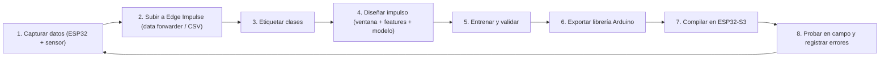

# 🧠 Inteligencia Artificial en el Borde (TinyML) — Estación Geofísica + Monitor Ambiental
> **v1.0** — Módulo complementario a `proyectos_GeofisicaAmbiental_v1.md`. Usa **solo el hardware ya comprado o planificado**. Toda la inferencia corre **localmente** en los ESP32, sin nube ni suscripciones.

---

## Tabla de Contenidos
1. [Qué es TinyML y por qué aquí](#1-qué-es-tinyml-y-por-qué-aquí)
2. [Hardware disponible y su capacidad para IA](#2-hardware-disponible-y-su-capacidad-para-ia)
   - [2b. Checklist de hardware — ¿Qué falta?](#2b--checklist-de-hardware-para-ia--qué-falta)
3. [Herramientas de software](#3-herramientas-de-software)
4. [Proyecto IA-1: Clasificador sísmico](#4-proyecto-ia-1--clasificador-sísmico-sismo-vs-ruido)
5. [Proyecto IA-2: Nowcasting de lluvia](#5-proyecto-ia-2--nowcasting-de-lluvia-local)
6. [Proyecto IA-3: Clasificador de cielo (visión)](#6-proyecto-ia-3--clasificador-de-cielo-visión)
7. [Proyecto IA-4: Detección acústica](#7-proyecto-ia-4--detección-acústica-ambiental)
8. [Proyecto IA-5: Detección de anomalías ambientales](#8-proyecto-ia-5--detección-de-anomalías-ambientales)
9. [Flujo de trabajo general (Edge Impulse)](#9-flujo-de-trabajo-general-edge-impulse)
10. [Código base: captura de datos](#10-código-base-captura-de-datos)
11. [Fases de implementación](#11-fases-de-implementación)
12. [Limitaciones y buenas prácticas](#12-limitaciones-y-buenas-prácticas)
13. [Recursos](#13-recursos)

---

## 1. Qué es TinyML y por qué aquí

**TinyML** = ejecutar modelos de Machine Learning (redes neuronales, árboles de decisión) directamente en microcontroladores de pocos mW.

| Enfoque | Dónde se procesa | Latencia | Internet | Privacidad | Costo mensual |
|---|---|:---:|:---:|:---:|:---:|
| IA en la nube (ChatGPT, APIs) | Servidor remoto | 0.5–3 s | Obligatorio | Datos salen de casa | Pago por uso |
| **TinyML (este proyecto)** | **El propio ESP32** | **1–100 ms** | **No necesario** | **Datos locales** | **\$0** |

> 💡 El objetivo **no** es reemplazar al CSN ni a un servicio meteorológico, sino que cada nodo **tome decisiones inteligentes por sí mismo**: filtrar falsas alarmas, anticipar lluvia, clasificar el cielo.

---

## 2. Hardware disponible y su capacidad para IA

### Microcontroladores

| Placa | Estado | CPU | PSRAM | Flash | Aceleración IA | Rol IA |
|---|:---:|---|:---:|:---:|:---:|---|
| **ESP32-S3 N16R8** (44 pines) | ✅ Comprada | Xtensa LX7 dual 240 MHz | **8 MB** | 16 MB | ✅ Instrucciones vectoriales (ESP-NN / ESP-DL) | **Cerebro IA principal** (sísmico, anomalías) |
| **XIAO ESP32-S3 Sense** | 🛒 Por adquirir | Xtensa LX7 dual 240 MHz | 8 MB | 8 MB | ✅ Vectorial | **Visión + audio** (cámara + micrófono PDM integrados) |
| **ESP32 DevKit 30P** (WROOM-32) | ✅ Comprada | Xtensa LX6 dual 240 MHz | — | 4 MB | ❌ | Modelos pequeños (árboles, MLP chica) |
| **ESP32-C3 Super Mini** | ✅ Comprada | RISC-V single 160 MHz | — | 4 MB | ❌ | Árboles de decisión / umbrales aprendidos |

> ⚠️ Verificar la memoria exacta del XIAO al comprarlo (las versiones actuales traen 8 MB PSRAM + 8 MB Flash).

### Sensores útiles para IA

| Sensor | Dato que genera | Proyecto IA |
|---|---|---|
| **ADXL345** | Aceleración 3 ejes (series temporales) | IA-1 Sísmico |
| **MPU6050** | Aceleración + giroscopio | IA-1 (canal auxiliar), IA-5 |
| **AHT20 + BMP280** (o BME280) | Presión, temperatura, humedad | IA-2 Nowcasting, IA-5 |
| **BH1750** | Lux | IA-2, IA-5 |
| **MQ-135 + ADS1115** | Calidad del aire (señal analógica 16 bit) | IA-5 Anomalías |
| **PIR HC-SR501** | Presencia | IA-5 (contexto) |
| **Cámara OV2640/OV3660 (XIAO Sense)** | Imágenes | IA-3 Visión |
| **Micrófono PDM (XIAO Sense)** | Audio | IA-4 Acústica |

### Presupuesto de memoria típico (referencial)

| Tipo de modelo | Tamaño modelo (int8) | RAM de inferencia | Tiempo en ESP32-S3 |
|---|:---:|:---:|:---:|
| Árbol de decisión / Random Forest pequeño | 5–50 KB | < 5 KB | < 1 ms |
| Red densa (MLP) 2–3 capas | 10–50 KB | 5–20 KB | 1–5 ms |
| CNN 1D (series de acelerómetro) | 30–150 KB | 20–100 KB | 5–30 ms |
| Espectrograma + CNN 2D (audio) | 50–200 KB | 50–150 KB | 20–100 ms |
| Visión 96×96 (MobileNet / FOMO) | 100–300 KB | 200 KB–1 MB (PSRAM) | 100–500 ms |

> Los valores son órdenes de magnitud para planificar; Edge Impulse muestra el consumo real antes de desplegar.

---

## 2b. ✅ Checklist de hardware para IA — ¿Qué falta?

> Estado según lo conversado hasta ahora. **"Verificar"** = estaba en la lista del proyecto pero no se ha confirmado la compra.

### 🔴 Hardware Esencial (100% Comprado)

| Ítem | Para qué proyecto | Tienda | Estado | Notas |
|---|---|:---:|:---:|---|
| **ESP32-S3 N16R8** | IA-1 (Sismos), IA-5 (Anomalías), Audio | ML | ✅ Comprado | Cerebro principal con 8 MB PSRAM ($13.434) |
| **XIAO ESP32-S3 Sense** | IA-3 (Visión cielo), IA-4 (Acústica) | Mechatronic | ✅ Comprado | Cámara OV2640, micrófono PDM y ranura SD ($22.990) |
| **ADXL345 GY-291 (×2)** | IA-1 (Clasificador sísmico vs ruido) | Mechatronic | ✅ Comprado | Acelerómetros a alta velocidad SPI ($6.980 total) |
| **AHT20 + BMP280 (×3)** | IA-2 (Nowcasting lluvia), IA-5 | AFEL | ✅ Comprado | *Nota: Compradas 3 uds (sugerido inicial 4; cubre 3 nodos)* ($9.000) |
| **Sensor de Lluvia** | IA-2 (Etiquetador de lluvia real) | Mechatronic | ✅ Comprado | Genera las etiquetas supervisadas del modelo ($1.500) |
| **Módulos Lector MicroSD SPI (×2)** | Datasets CSV continuos en nodos | AFEL | ✅ Comprado | *Nota: Compradas 2 uds (sugerido inicial 3; XIAO ya trae ranura)* ($5.000) |
| **Tarjeta MicroSD Maxell 16GB** | Datasets de entrenamiento en FAT32 | ML | ✅ Comprado | *Nota: Comprada 1 ud inicial de 16GB (sugerido 3-4)* ($7.990) |
| **Xiaomi Cable USB-C de DATOS 1m** | Captura serial y programación en PC | ML | ✅ Comprado | *Nota: Comprado 1 cable datos de alta velocidad (sugerido 2-3)* ($6.990) |

### 🟡 Audio, Actuadores y Diálogo con IA (100% Comprado)

| Ítem | Para qué | Tienda | Estado | Notas |
|---|---|:---:|:---:|---|
| **Micrófono I2S INMP441** | IA-4 / Oído de DeepSeek (KWS) | AFEL | ✅ Comprado | Entrada de voz omnidireccional digital directa al S3 ($5.990) |
| **Amplificador I2S MAX98357A 3W** | Salida de voz humana (TTS) / Robot | ML | ✅ Comprado | DAC + Amplificador clase D digital sin pérdida ($5.890) |
| **Mini Parlante 3W 4Ω** | Boca del Robot / Alertas parlantes | AFEL | ✅ Comprado | Respuesta acústica de alta fidelidad ($3.000) |
| **Micro Servomotores SG90 (×2)** | Paneo cámara / Patas robot mascota | AFEL | ✅ Comprado | Servos de posición angular analógica ($3.980) |
| **Potenciómetros WH148 B10K (×3)** | Calibración manual de sensibilidad IA | AFEL | ✅ Comprado | *✅ Compradas 3 uds (sugerido inicial 2)* ($1.500) |
| **Buzzer Pasivo Solo (×2)** | Alarmas sonoras de emergencia | AFEL | ✅ Comprado | Alarma local piezoeléctrica ($600) |
| **MQ-135 + ADS1115** | IA-5 (Detección anomalías de aire) | AFEL | ✅ Comprado | Lectura de gas con resolución 16-bit ($11.800) |
| **BH1750 (×2)** | IA-2 / Luz para inferencia de nubes | Mechatronic | ✅ Comprado | *Nota: Compradas 2 uds (sugerido inicial 3)* ($7.980) |
| **Radar Microondas RCWL-0516** | Detección de presencia invisible | Mechatronic | ✅ Comprado | Despierta al robot o nodo al acercarse ($2.290) |
| **Infrarrojo HW-201 + Ultrasonido HC-SR04** | Detección obstáculos y distancia robot | Mech / AFEL | ✅ Comprado | Navegación y proximidad ($2.990 total) |
| **Maletín Organizador Plástico** | Almacenamiento seguro de componentes | ML | ✅ Comprado | Caja con compartimientos transparente ($5.661) |

### 🟢 Opcional para fases futuras (cuando se expanda la instalación)

| Ítem | Para qué | Notas |
|---|---|---|
| **Más tarjetas MicroSD 16-32GB** | Expandir logging simultáneo a todos los nodos satélite | Reutilizar la tarjeta Maxell en el Hub para partir |
| **Lector MicroSD USB para PC** | Si tu PC no tiene ranura MicroSD o lector multitarjeta | Barato en retail o ferretería (~$2.000) |
| **Base rígida baldosa para sismógrafo** | Fijar el ADXL345 sólidamente al piso | Retazo de baldosa + silicona |
| **Caja estanca IP65** | Para dejar el nodo exterior en el patio definitivo | Instalar tras probar en interiores |

### 💻 Software / PC (sin costo — $0)

| Ítem | Notas |
|---|---|
| Cuenta en **Edge Impulse** | Plan gratuito para desarrolladores; entrena en la nube (**no necesitas GPU**) |
| **Node.js** + `edge-impulse-cli` | Para el data forwarder directo por puerto USB |
| **Arduino IDE 2.x** + soporte ESP32 (Espressif) | Compilar sketches, librerías y modelos exportados |
| **Python 3 + Jupyter + scikit-learn + pandas** | Para IA-2 y IA-5 con datasets descargados en CSV |
| **API de DeepSeek / OpenAI** | Para conectar el ESP32-S3 por WiFi y dialogar por voz con el robot |

### 💰 Inversión Real Consolidada en Hardware

| Tienda | Monto Pagado | Cobertura |
|---|:---:|---|
| **Mercado Libre** | **$130.039 CLP** | Microcontroladores, herramientas pro, cable Xiaomi, MicroSD Maxell, maletín y MAX98357A |
| **MechatronicStore** | **$70.760 CLP** | XIAO ESP32-S3 Sense, sensores sísmicos, radar, lluvia, láser, flux, alcohol, pinzas |
| **AFEL** | **$92.970 CLP** | Sensores AHT20+BMP280, MQ-135, audio (INMP441 + parlante), servos, kit básico, cables |
| **TOTAL GENERAL** | **$293.769 CLP** | **100% financiado y comprado. Cero ítems pendientes en carritos.** |

---

## 3. Herramientas de software

| Herramienta | Para qué | Dificultad | Recomendación |
|---|---|:---:|---|
| **[Edge Impulse](https://edgeimpulse.com)** | Captura, etiquetado, entrenamiento y exportación como librería Arduino | ⭐ Baja | **Empezar aquí** (plan gratuito para desarrolladores) |
| **TensorFlow Lite Micro / LiteRT for Microcontrollers** | Framework de Google para correr redes en MCU | ⭐⭐⭐ Media-alta | Fase avanzada |
| **ESP-NN** | Kernels optimizados de Espressif para TFLite Micro en ESP32-S3 | ⭐⭐ | Se usa automáticamente vía librerías |
| **ESP-DL** | Librería de deep learning de Espressif (visión, detección de rostros) | ⭐⭐⭐ | Para IA-3 avanzado |
| **Python + scikit-learn + Jupyter** | Análisis de datos de la MicroSD y entrenamiento de árboles | ⭐⭐ | IA-2 / IA-5 |
| **micromlgen / m2cgen / emlearn** | Convierte modelos scikit-learn a código C para Arduino | ⭐⭐ | Para ESP32 clásico y C3 |

---

## 4. Proyecto IA-1 — Clasificador sísmico (sismo vs ruido)

### Problema
El algoritmo STA/LTA (ver documento principal) dispara con **cualquier** vibración fuerte: camiones, portazos, pasos, lavadora. Resultado: muchas falsas alarmas.

### Solución
Un modelo que analiza la **forma de la señal** en una ventana de tiempo y clasifica el origen.

```text
ADXL345 (100–200 Hz) ──► Ventana 2 s ──► Extracción espectral ──► Red neuronal ──► Clase + probabilidad
                                         (FFT / bandas)          (MLP o CNN 1D)
                    STA/LTA dispara ─────────────────────────────────┘ (solo se infiere tras un disparo)
```

### Clases propuestas

| Clase | Cómo obtener ejemplos |
|---|---|
| `quieto` | Grabar la estación en reposo (noche) |
| `pasos` | Caminar cerca de la estación |
| `golpe` | Portazos, golpes en la mesa/suelo |
| `trafico` | Grabar en horario de tráfico pesado |
| `maquina` | Lavadora, bomba de agua, refrigerador |
| `sismo` | Sismos reales registrados + **mesa vibratoria casera** (ver nota) |

> ⚠️ **El reto es la clase `sismo`**: hay pocos ejemplos propios. Estrategias:
> 1. Registrar los sismos reales que ocurran (en Chile son frecuentes) y **confirmarlos con el catálogo del CSN**.
> 2. Descargar registros de aceleración de bases públicas (IRIS, CSN) y **reescalarlos/remuestrearlos** al formato del ADXL345.
> 3. Simular ondas de baja frecuencia (1–10 Hz) con una plataforma oscilante manual.

### Características (features) recomendadas
- Energía por bandas de frecuencia: 0.5–2 Hz, 2–5 Hz, 5–10 Hz, 10–20 Hz, 20–50 Hz
- Duración del evento (s)
- Relación entre ejes: vertical vs horizontal (las ondas P son más verticales)
- Pico de aceleración (PGA) y RMS

### Modelo
- **Inicio:** bloque *Spectral Analysis* de Edge Impulse + red densa (MLP) → simple y muy rápida.
- **Avanzado:** CNN 1D sobre la señal cruda en el ESP32-S3 (usa PSRAM).

### Integración con el sistema
```text
if STA/LTA > umbral:
    clase, p = modelo(ventana_2s)
    if clase == "sismo" and p > 0.85:
        → MQTT geofisica/eventos {tipo:"sismo", p, pga, duracion}
        → Telegram alerta
    else:
        → log en MicroSD como "falsa_alarma" (sirve para reentrenar)
```

### Validación científica
Comparar durante semanas: **eventos detectados por la IA vs catálogo del CSN** → calcular precisión, recall y matriz de confusión.

---

## 5. Proyecto IA-2 — Nowcasting de lluvia local

### Problema
El pronóstico de la ciudad no describe lo que pasa en tu techo en las próximas horas.

### Solución
Con el histórico de la MicroSD, entrenar un modelo que estime **probabilidad de lluvia en las próximas 3 h**.

| Entrada (features) | Fuente |
|---|---|
| Presión actual (hPa) | BME280 |
| Tendencia de presión $\Delta P_{1h}$, $\Delta P_{3h}$ | BME280 (calculado) |
| Humedad relativa y su tendencia | BME280 |
| Punto de rocío y diferencia temp − rocío | Calculado |
| Lux (nubosidad diurna) | BH1750 |
| Hora del día, mes (codificados sin/cos) | RTC / NTP |
| **Etiqueta**: ¿llovió en las siguientes 3 h? | **Sensor de lluvia** del nodo exterior |

Punto de rocío (aproximación de Magnus):

$$T_d = \frac{b\,\gamma}{a - \gamma}, \qquad \gamma = \ln\!\left(\frac{HR}{100}\right) + \frac{a\,T}{b + T}, \quad a = 17.62,\; b = 243.12\,^\circ\text{C}$$

### Modelo
- **Random Forest** o **árbol de decisión** en scikit-learn → exportado a C con `micromlgen` o `emlearn`.
- Corre incluso en el **ESP32-C3** del nodo exterior.

### Requisito clave
> ⏳ Necesita **datos acumulados**: idealmente **3–6 meses** de registros incluyendo días de lluvia. Empezar a guardar datos desde la Fase 1 aunque el modelo se entrene después.

---

## 6. Proyecto IA-3 — Clasificador de cielo (visión)

### Hardware
**XIAO ESP32-S3 Sense** (cámara + MicroSD integrada), apuntando al cielo.

### Clases

| Clase | Descripción |
|---|---|
| `despejado` | Cielo azul sin nubes |
| `parcial` | Nubes dispersas |
| `cubierto` | Cielo totalmente nublado |
| `noche` | Baja luminosidad |
| `lluvia_niebla` | Gotas en el lente / visibilidad reducida |

### Flujo
```text
Foto horaria (JPG) ──► MicroSD (dataset) ──► Etiquetado en Edge Impulse ──► Modelo 96×96
         │                                                                      │
         └──────────────── en producción ──► Inferencia local ──► MQTT cielo/estado {clase, p}
```

### Valor científico
- Correlacionar **clase de cielo** con **lux (BH1750)** y **presión (BME280)**.
- Alimentar al modelo IA-2 como feature adicional (`cobertura_nubosa`).

> 💡 Proteger la cámara con una cúpula transparente y considerar el sol directo (puede saturar el sensor).

---

## 7. Proyecto IA-4 — Detección acústica ambiental

### Hardware
Micrófono PDM integrado del **XIAO ESP32-S3 Sense**.

### Clases posibles
| Clase | Aplicación |
|---|---|
| `lluvia` | Confirmación acústica de lluvia en techo (redundancia del sensor de lluvia) |
| `viento_fuerte` | Alertas de viento |
| `ladrido` / `voz` | Contexto de actividad (sin grabar contenido) |
| `alarma` | Detectar alarmas de humo o sirenas |
| `silencio` / `fondo` | Clase base obligatoria |

### Técnica
Audio 16 kHz → ventanas de 1 s → **MFE / espectrograma Mel** → CNN 2D pequeña.

> 🔒 **Privacidad:** el audio se procesa en memoria y se descarta; solo se publica la clase detectada.

---

## 8. Proyecto IA-5 — Detección de anomalías ambientales

### Idea
En vez de definir umbrales fijos (ej. CO₂ > 1000), el sistema **aprende qué es "normal"** en cada habitación y alerta cuando algo se sale del patrón.

| Ejemplo de anomalía | Señales combinadas |
|---|---|
| Ventana abierta en invierno | Caída rápida de temperatura + cambio de humedad |
| Fuga de gas / humo | MQ-135 sube fuera del patrón horario |
| Falla de sensor | Lectura congelada o saltos imposibles |
| Vibración inusual de la casa | MPU6050 / ADXL345 fuera del perfil diario |

### Técnica
- **K-means** o **autoencoder pequeño** (Edge Impulse incluye bloque *Anomaly Detection*).
- Puntaje de anomalía por ventana → alerta si supera un umbral aprendido.

---

## 9. Flujo de trabajo general (Edge Impulse)



### Pasos concretos
1. Crear cuenta en [edgeimpulse.com](https://edgeimpulse.com) y un proyecto.
2. Instalar **Node.js** y **Edge Impulse CLI**: `npm install -g edge-impulse-cli`
3. Cargar en el ESP32 el sketch de captura (sección 10).
4. Ejecutar `edge-impulse-data-forwarder` → detecta el puerto y la frecuencia automáticamente.
5. Grabar **mínimo 5–10 minutos por clase**, en distintas condiciones.
6. En *Impulse design*: ventana 2000 ms, paso 500 ms, bloque *Spectral Analysis*, bloque *Classification*.
7. Entrenar → revisar matriz de confusión → objetivo inicial **> 85 % de exactitud** en validación.
8. *Deployment* → **Arduino library** → *Quantized (int8)* → importar el `.zip` en Arduino IDE.
9. Abrir el ejemplo `esp32_fusion` / `static_buffer` de la librería y adaptarlo.

---

## 10. Código base: captura de datos

### 10.1 Captura del ADXL345 para Edge Impulse (data forwarder)

```cpp
// Captura ADXL345 a frecuencia fija para edge-impulse-data-forwarder
// Placa: ESP32-S3 N16R8 | Librerías: Adafruit ADXL345, Adafruit Unified Sensor
#include <Wire.h>
#include <Adafruit_Sensor.h>
#include <Adafruit_ADXL345_U.h>

#define FREQ_HZ      100                      // 100 Hz cubre la banda sísmica útil (< 50 Hz)
#define INTERVAL_US  (1000000UL / FREQ_HZ)

Adafruit_ADXL345_Unified accel(12345);

void setup() {
  Serial.begin(115200);
  Wire.begin();                 // Ajustar pines SDA/SCL según el cableado del documento principal
  Wire.setClock(400000);        // I2C rápido
  if (!accel.begin()) {
    Serial.println("ERROR: ADXL345 no detectado");
    while (true) delay(1000);
  }
  accel.setRange(ADXL345_RANGE_2_G);          // Máxima sensibilidad para microvibraciones
  accel.setDataRate(ADXL345_DATARATE_200_HZ); // ODR del sensor > frecuencia de muestreo
}

void loop() {
  static uint32_t last = micros();
  if (micros() - last >= INTERVAL_US) {
    last += INTERVAL_US;
    sensors_event_t e;
    accel.getEvent(&e);
    // Formato que entiende el data forwarder: valores separados por coma, una línea por muestra
    Serial.printf("%.4f,%.4f,%.4f\n", e.acceleration.x, e.acceleration.y, e.acceleration.z);
  }
}
```

### 10.2 Registro ambiental para entrenamiento posterior (IA-2 / IA-5)

```text
Archivo: /ia/ambiente_YYYYMMDD.csv  (cada 60 s)
timestamp,presion_hPa,temp_C,hum_pct,lux,mq135_raw,pir,lluvia
2026-10-08T19:00:00,1013.42,14.8,71.2,0,10342,0,0
```

> 📌 La columna `lluvia` (sensor del nodo exterior) es la **etiqueta** para el modelo de nowcasting. Sin ella no se puede entrenar IA-2.

### 10.3 Esqueleto de inferencia (después de exportar desde Edge Impulse)

```cpp
#include <tu_proyecto_inferencing.h>   // Nombre generado por Edge Impulse

float buffer[EI_CLASSIFIER_DSP_INPUT_FRAME_SIZE];

void clasificar() {
  signal_t signal;
  numpy::signal_from_buffer(buffer, EI_CLASSIFIER_DSP_INPUT_FRAME_SIZE, &signal);
  ei_impulse_result_t result;
  if (run_classifier(&signal, &result, false) != EI_IMPULSE_OK) return;

  for (size_t i = 0; i < EI_CLASSIFIER_LABEL_COUNT; i++) {
    Serial.printf("%s: %.2f\n", result.classification[i].label, result.classification[i].value);
  }
  // → publicar por MQTT la clase con mayor probabilidad
}
```

---

## 11. Fases de implementación

> Se integra con las fases del documento principal. La IA **empieza a recolectar datos desde el día 1**, aunque los modelos se entrenen después.

```text
FASE IA-0 — Junto a Fase 1 (semanas 1–2)
  ├── Crear cuenta Edge Impulse + instalar CLI
  ├── Activar registro CSV ambiental en MicroSD (10.2) — ¡no esperar!
  └── Probar data forwarder con el ADXL345 (10.1)

FASE IA-1 — Semanas 3–5: Primer modelo (sísmico)
  ├── Grabar clases quieto / pasos / golpe / tráfico / máquina
  ├── Entrenar MLP con Spectral Analysis
  ├── Desplegar en ESP32-S3 y medir latencia y RAM
  └── Integrar con STA/LTA como filtro de falsas alarmas

FASE IA-2 — Semanas 6–8: Visión y audio (XIAO Sense)
  ├── Captura horaria de fotos del cielo → dataset
  ├── Etiquetar ≥ 50 imágenes por clase
  ├── Entrenar clasificador de cielo 96×96
  └── Prototipo acústico: lluvia vs fondo

FASE IA-3 — Meses 3–6: Modelos con datos acumulados
  ├── Nowcasting de lluvia (Random Forest → C)
  ├── Detección de anomalías por habitación
  └── Reentrenar sísmico con eventos reales confirmados por CSN

FASE IA-4 — Avanzado
  ├── CNN 1D sobre señal cruda (TFLite Micro + ESP-NN)
  ├── Fusión de sensores: cielo + presión + lux → nowcasting mejorado
  └── Comparar dos nodos sísmicos: ¿ambos clasifican el mismo evento?
```

---

## 12. Limitaciones y buenas prácticas

| ⚠️ Limitación | Mitigación |
|---|---|
| Pocos ejemplos de sismos reales | Datos públicos (IRIS/CSN) reescalados + acumular eventos propios |
| El ADXL345 es ruidoso para sismos lejanos/débiles | Solo esperar detectar sismos **sentidos** en la zona; documentar el umbral real |
| Sobreajuste (*overfitting*) con datasets chicos | Separar entrenamiento/validación por **día**, no al azar |
| Cambios de montaje alteran la señal | Fijar la estación siempre igual (idealmente anclada al piso) |
| MQ-135 deriva con el tiempo | Reentrenar o recalibrar periódicamente; usar anomalías relativas |
| Modelos grandes no caben en ESP32 clásico/C3 | Dejar redes neuronales al S3; árboles en C3 |

### Buenas prácticas
- ✅ **Guardar siempre los datos crudos** — permiten reentrenar con mejores modelos.
- ✅ Registrar en MicroSD cada predicción con su probabilidad → base para evaluar el modelo.
- ✅ Usar **cuantización int8** (reduce ~4× el tamaño con pérdida mínima de exactitud).
- ✅ Medir métricas reales: **precisión, recall, F1, matriz de confusión** — no solo "exactitud".
- ✅ Versionar modelos: `sismo_v1`, `sismo_v2`… y anotar con qué datos se entrenó cada uno.

---

## 13. Recursos

- 📘 [Edge Impulse — Documentación](https://docs.edgeimpulse.com)
- 📘 [Edge Impulse — Data forwarder](https://docs.edgeimpulse.com/docs/tools/edge-impulse-cli/cli-data-forwarder)
- 📘 [Seeed Studio — XIAO ESP32-S3 Sense Wiki](https://wiki.seeedstudio.com/xiao_esp32s3_getting_started/)
- 📘 [Espressif ESP-DL](https://github.com/espressif/esp-dl) · [ESP-NN](https://github.com/espressif/esp-nn)
- 📘 [TensorFlow Lite Micro](https://github.com/tensorflow/tflite-micro)
- 📘 [emlearn — ML para microcontroladores](https://github.com/emlearn/emlearn)
- 📗 Libro: *TinyML* — Pete Warden & Daniel Situnayake (O'Reilly)
- 🌐 [CSN Chile — Catálogo sísmico](https://www.csn.uchile.cl/sismicidad/catalogo-sismico/) (validación IA-1)
- 🌐 [IRIS — Datos sísmicos](https://ds.iris.edu/ieb/) (datos de entrenamiento)

---

> **v1.0** — Documento inicial de IA embebida. Cinco proyectos TinyML (sísmico, nowcasting, visión de cielo, acústica, anomalías) sobre ESP32-S3 N16R8, XIAO ESP32-S3 Sense, ESP32 DevKit y ESP32-C3. Sin hardware adicional requerido.
